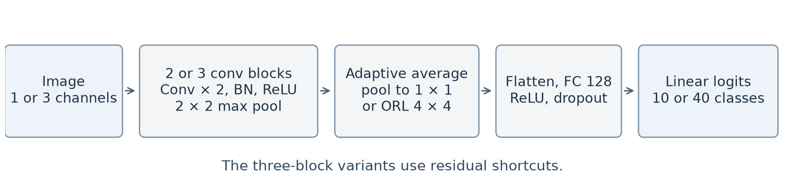
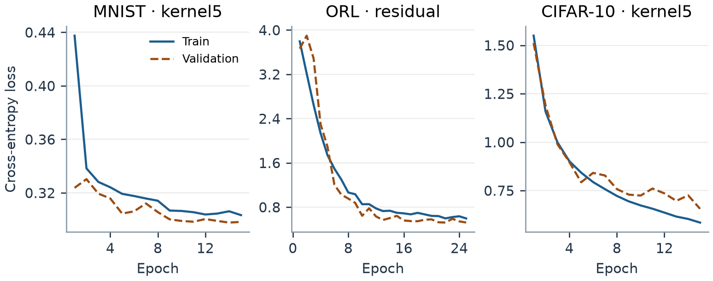

# Stage 3 Experiment Results

| Dataset | Selected model | Test images | Accuracy | Macro precision | Macro recall | Macro F1 |
| --- | --- | ---: | ---: | ---: | ---: | ---: |
| [MNIST](mnist/experiment_summary.json) | Kernel 5×5 residual | 10,000 | 99.60% | 99.60% | 99.59% | 99.60% |
| [ORL](orl/experiment_summary.json) | Kernel 3×3 residual | 40 | 97.50% | 96.25% | 97.50% | 96.67% |
| [CIFAR-10](cifar10/experiment_summary.json) | Kernel 5×5 residual | 10,000 | 84.95% | 85.12% | 84.95% | 84.88% |

## Dataset and run provenance

The ORL experiment used the instructor ZIP and the [template entry point](../../script/stage_3_script/script_cnn_orl.py). A stratified split allocated 270 training images to model fitting and 90 to validation. The instructor's 40 test images were held out. The two residual variants tied on validation macro F1, so the 3×3 variant, which was listed first, was selected.

MNIST and CIFAR-10 were trained earlier using the [standalone entry point](../../script/stage3/run_stage3.py) with 15 epochs, batch size 128, seed 42, and the cached torchvision datasets. Both cached datasets matched the supplied ZIP in pixel values, labels, and record order for both partitions. I scored the saved checkpoints again through the template loader on the instructor ZIP. Validation and held-out metrics matched the recorded runs for [MNIST](mnist/checkpoint_verification.json) and [CIFAR-10](cifar10/checkpoint_verification.json).

Every experiment selected checkpoints and architectures on validation data. The linked summaries include validation ablations, hyperparameters, split counts, and the course archive SHA-256. Each dataset directory also includes epoch loss histories for all three configurations.

## Architecture and convergence

